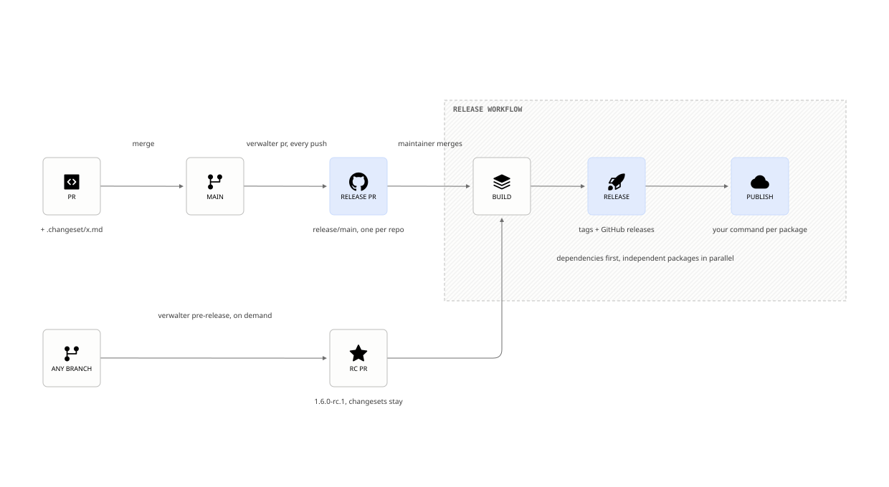

# verwalter

> [!WARNING]
> **Work in progress.** verwalter is under active development and is not
> ready for production use. Commands, configuration keys and behaviour can
> change without notice between releases. Use it at your own risk, and
> expect rough edges and breaking changes.

Changeset-based versioning for single packages and monorepos, in any
language. Contributors describe their change in a changeset file. The tool
keeps one release PR open. Merging it bumps versions, writes changelogs,
tags, creates GitHub releases and runs your publish commands, dependencies
first.

<picture>
  <source media="(prefers-color-scheme: dark)" srcset="docs/release-cycle-dark.svg">
  
</picture>

The behaviour is specified in [specs/versioning.allium](specs/versioning.allium).

## Installation

With [cargo binstall](https://github.com/cargo-bins/cargo-binstall), which
downloads the binary of the latest release:

```sh
cargo binstall verwalter
```

Or build it from crates.io:

```sh
cargo install --locked verwalter
```

The binaries for Linux (x86_64, aarch64) and macOS (aarch64) are on the
[releases page](https://github.com/livekit/verwalter/releases). In GitHub
Actions use the action, see below.

### From source

```sh
git clone https://github.com/livekit/verwalter
cd verwalter
cargo install --locked --path .
verwalter --version  # Verify install
```

## Quick start

**1. Describe the packages** in `verwalter.toml` at the repository root.
The first versioned file of a package carries its version. Dependencies
between packages are read from the manifests. Every package is tagged
and gets a GitHub release unless `release.mode` says otherwise.

```toml
#:schema https://raw.githubusercontent.com/livekit/verwalter/refs/heads/main/schemas/v1.json
[versioning]
files = ["Cargo.toml"]             # for every package; a package can set its own

[publish]
registry = "crates"                # none | crates | npm | pypi | pubdev | goproxy | custom

[packages.livekit-protocol]
path = "livekit-protocol"

[packages.livekit-api]
path = "livekit-api"
```

Files are relative to each package's `path`, and the changelog is
`CHANGELOG.md` in the package unless `changelog` says otherwise, or `false`
for none. A single package uses `path = "."`. A version in another text
file takes a regex: `{ path = "version.go", regex = 'Version = "(?<version>[^"]+)"' }`.

**2. Copy the workflows** from [examples/workflows](examples/workflows):

| Workflow | When | What |
|---|---|---|
| `changeset-check.yml` | A PR is opened or updated | Fails a PR that changes a package without a changeset, with a comment and a prefilled link. On a passing PR the comment lists the bumps it claims and the dependents released with them. |
| `release-pr.yml` | A push to `main` | Opens or updates the one release PR. |
| `release.yml` | The release PR merges | Builds, tags, creates the GitHub releases, then publishes. |
| `pre-release.yml` | Run by hand, optional | Opens an rc PR for everything with a pending changeset, from the chosen branch. |

Each one is a single step of the action:

```yaml
- uses: livekit/verwalter@v0.22.0
  with:
    command: pr        # check | pr | release | publish | pre-release | status
```

**3. Allow Actions to open PRs**: Settings → Actions → General → "Allow
GitHub Actions to create and approve pull requests". Create a label named
`internal` for PRs that need no release.

**4. Write a changeset** in each PR that changes a package, in the
[changesets](https://github.com/changesets/changesets) format. The check
comment links to a prefilled file, or run `verwalter changeset --level minor`
on the branch.

```md
---
livekit-protocol: minor
---

Negotiated data channels.
```

From here on, every push to `main` keeps the release PR current. Merging
it releases. If a step fails, re-run the workflow: nothing is remembered
between runs, the tool reads tags and releases and finishes what is
missing.

## What it does

- **One release PR** with every package that has a pending changeset.
  Dependents get a `patch` bump and ride along. Each push regenerates the
  branch from `main`, so it never conflicts.
- **Versions in any file**: manifests and lock files by format, any other
  text file by regex.
- **Changelogs** with the PR number and author of each changeset.
- **Tags and GitHub releases** with assets, dependencies first, resumable.
- **Publish** runs your command per package, independent packages in
  parallel. A version the registry already has is skipped. A failure blocks
  its dependents and nothing else.
- **Pre-releases** on demand: `verwalter pre-release` opens an rc PR from
  any branch for everything with a pending changeset.
- **Checks** on contributor PRs: a missing or invalid changeset, a package
  missing from the config, and with a tool such as cargo-semver-checks, a
  changeset level below what the API change needs.

## Going deeper

| Document | Contents |
|---|---|
| [docs/configuration.md](docs/configuration.md) | Every key of `verwalter.toml`: fixed groups, bump ceilings, drafts, publish commands, workspace publish, versioned files. |
| [docs/action.md](docs/action.md) | Action inputs and outputs, the workflows, repository settings. |
| [docs/adopt.md](docs/adopt.md) | Adopting verwalter in a repository that releases with changesets/action, knope, release-plz, a bump script or hand-pushed tags: the procedure, the mapping per tool, the traps. |
| [docs/features.md](docs/features.md) | The full feature list, the mistakes the tool catches, what to do when a step fails, what is not covered. |
| [docs/api-check.md](docs/api-check.md) | Verifying the changeset level with cargo-semver-checks, griffe or break-check. |
| [docs/commands.md](docs/commands.md) | Every command and flag. |
| [examples/publish/README.md](examples/publish/README.md) | Publish commands per registry. |
| [docs/release-pitfalls.md](docs/release-pitfalls.md) | The release history of the LiveKit SDKs and how each pitfall maps to the tool. |

## Agent skill

[skills/verwalter](skills/verwalter/SKILL.md) teaches a coding agent to
use verwalter and points it at the documents above, with
[docs/adopt.md](docs/adopt.md) for a repository that releases another
way today. Copy the directory into `.claude/skills/` of the repository,
or install it with `npx skills add livekit/verwalter`.

Install the binary from the
[releases page](https://github.com/livekit/verwalter/releases) to run any
command locally, or `cargo install --git https://github.com/livekit/verwalter --tag v0.22.0`.
